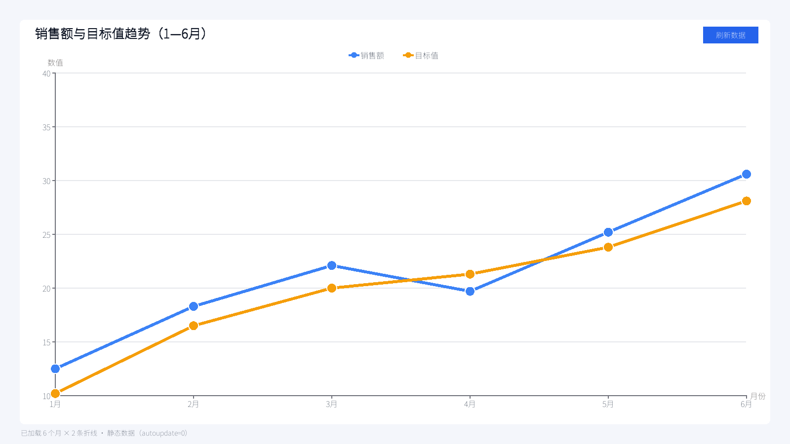

# XCharts 双折线图示例（Unity 2022.3 + XCharts 3.15.0）

在原有单折线图基础上扩展的第二条折线示例：读取 `LineData.json`，同时渲染「销售额 / 目标值」两条折线，并支持每 2 秒模拟实时刷新。

**在线演示**（WebGL 构建，浏览器直接跑）：<https://hamiyayui.github.io/xcharts-line-demo/>

## 运行

1. 用 Unity **2022.3.62f3c1** 打开本目录。
2. 打开 `Assets/Scenes/LineChartDemo.unity`，点击 **Play**（Game 视图建议 1600 × 900）。
3. 点击右上角「刷新数据」或按 **R** 键可重新读取 JSON。
4. WebGL：菜单 **XCharts Demo → 构建 WebGL**，产物在 `Builds/WebGL/`。

## 数据

`Assets/StreamingAssets/LineData.json`：

- `XAxis`：1—6 月，两条折线共用
- `YValues`：第一条折线（原有数据，未修改）
- `YValues2`：第二条折线（新增，`10.2, 16.5, 20.0, 21.3, 23.8, 28.1`）

## 功能对照

| 要求 | 实现 |
|---|---|
| 双折线、不同颜色 | Serie「销售额」#3B82F6 /「目标值」#F59E0B |
| 图例显隐 | Legend（TopCenter），点击切换 |
| X 轴全部月份 + 轴名 | `axisLabel.interval = 0`，`axisName = 月份` |
| Y 轴自动适配 | `minMaxType = MinMaxAuto`，`axisName = 数值` |
| Tooltip 同时显示两组数值 | `Tooltip.Trigger.Axis` + `MouseMove` |
| 实时刷新 | 每 2 秒修改 5、6 月两组数据，`UpdateData` + `RefreshChart` |
| 加分项 | 第二组数据从 JSON 读取；拐点圆点标记 |

## 主要文件

- `Assets/Scripts/LineChartController.cs` — 双折线创建、配置、数据加载、实时刷新
- `Assets/Scripts/LineDataModel.cs` — JSON 数据模型
- `Assets/StreamingAssets/LineData.json` — 数据源
- `Assets/Editor/DemoBuild.cs` — 一键生成场景 / 构建 WebGL
- `docs/` — 已构建的 WebGL 页面（GitHub Pages 源）+ `双折线图表实现说明.pdf`
- `Screenshots/` — 运行截图

## 发布到 GitHub Pages

仓库 Settings → Pages → Source 选 **Deploy from a branch**，分支 `main`、目录 `/docs`，保存即可。
`docs/` 里已包含现成的 WebGL 构建和 `.nojekyll`。

## 说明

XCharts 3.15.0 源码包放在 `Packages/com.monitor1394.xcharts`（MIT 协议）。

## 许可

本示例代码 MIT。XCharts 为 MIT（见其 `package.json` 与仓库）。
